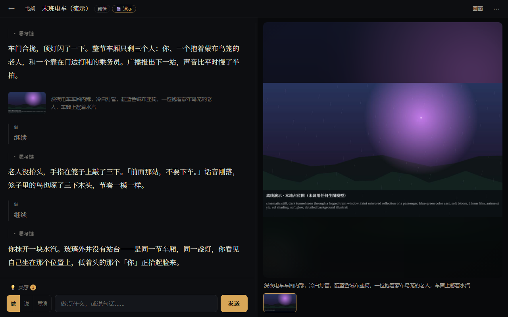

# 无限阅读 · ∞ Reading

[](LICENSE)
[](CHANGELOG.md)
[](#架构)
[](#快速开始)
[](README.en.md)

> 有限的书页，无限的故事。

一本「读不完」的 AI 视觉小说：你和 AI 即兴演出剧情，AI 画师为每一幕现场作画。

**纯前端 · 零构建 · 零依赖 · 无后端**：双击 `index.html` 就能玩，数据只存在你自己的浏览器里。

**当前版本 v0.3** ｜ 文档：[架构](ARCHITECTURE.md) · [设计稿](docs/DESIGN.md) · [调研与规划](docs/NOTES.md) · [更新日志](CHANGELOG.md) · [参与贡献](CONTRIBUTING.md) · [安全说明](SECURITY.md) · [English](README.en.md)

## 特色

- 🎭 **自由演出**：自由输入，或点 AI 给出的分支选项
- 🎨 **AI 画师现场作画**：提示词可见可改，还能与画师对话改画
- 🧭 **三种模式**：剧情 / 智能体（带工具的助手：画图、记事、定时、写邮件、下单，后两样要你确认）/ 角色扮演（角色卡 + 关系记忆 + 用户画像，兼容 SillyTavern V2/V3 卡）
- 🧠 **记得住**：世界状态卡 + 按需召回 + 70% 自动压缩，长局不忘前情
- 📚 **玩得久**：故事书架、存档点、`.irstory.json` 导入导出、剧情文本导入
- 🔌 **模型随便换**：对话与生图分离，兼容所有 OpenAI 格式接口（云端 / 本地，Base URL 自填）
- 🎬 **离线演示**：加 `?demo=1` 就能在不配 Key、不联网的情况下走完整流程（内置剧本 + 本地占位图）
- 🎬 **视频已留座**：适配器层预留 `VideoProviders`（可灵 / Vidu 等异步任务型 API），尚未实现

## 先看演示（零安装 · 零配置）

不想填 Key、也不想先搭环境？**在地址后面加 `?demo=1` 就能直接开演**：

```
index.html?demo=1
```

内置 10 回合剧本 + 本地占位图（canvas 现场画的），不联网、不花额度、不需要任何配置；
剧情、选项、画师子代理、出图、画师工作台、存档、书架全都跑同一条真实链路，只是把「模型」换成了内置脚本。



- **在线 Demo**：`https://LiSheng5.github.io/infinite-reading/?demo=1`（仓库 Settings → Pages → Source 选「GitHub Actions」即启用，工作流已随仓库提供）
- **一个文件带走**：`npm run bundle` 生成 `dist/ir.html`（约 530 KB，HTML/CSS/JS 全部内联），可以直接当附件发出去，双击就能玩
- 想接真模型：去掉地址栏的 `?demo=1`（顶栏那个「🎬 演示」小胶囊就是入口），回首页点「⚙ 接入模型」即可。演示模式**不会写盘任何配置**，你原来的设置不会被弄脏。

## 快速开始

用 git 取一份（也可以点仓库页的 **Code → Download ZIP**，无需 git）：

```bash
git clone git@github.com:LiSheng5/infinite-reading.git   # 或 https://github.com/LiSheng5/infinite-reading.git
cd infinite-reading
```

1. 启动（任选其一）：
   - **Windows 一键**：双击 `启动.bat`——起本地服务并自动打开浏览器（优先用 Python，没有就退回内置的 PowerShell 服务器）
   - 双击 `index.html`（纯前端，无构建、无依赖）
   - 本地静态服务（更稳，推荐）：`npx serve .` 或 `python -m http.server 8000`
2. 点「⚙ 接入模型」，填 **Base URL**（下拉可选，也可手填）、**API Key**、**模型名**（生图模型同理）。
3. **点一张模式卡就开局**：开始页上有三张模式卡——**剧情**（用下面的「故事设定」框开一局）、**智能体**（带工具的助手：能画图、记事、定时、写邮件、下单，后两样都要你确认）、**扮演**（先建 / 导入角色卡）。点哪张就直接按哪种模式开局，**没有单独的「开始」按钮**；「故事设定」框常驻，只给剧情模式用。
   - 「📄 文本导入」：把现成文本（设定文 / 小说片段 / 聊天记录）交给 AI 整理成开局材料，确认后再建新档。
   - 「☰ 我的书架」进故事列表（继续 / 改名 / 删除 / 导出），「↶ 继续上次」直接回到上一个故事；书架里的「＋新故事」也能选模式开局。
   - 进了故事：**剧情模式是「左文右图」**——左边只排文字（旁白是正文，玩家发言弱化成一侧细线 + 做/说/导演小标签），右边是舞台（当前画面 + 缩略条）；**智能体 / 扮演是纯聊天布局**（没有画面区，图片直接内联在聊天流里，点图开大图）。顶栏左上「←」是**回首页**，旁边是书架与标题；存档点、新故事、为当前场景作画、模型设置都收在右上角「⋯」里（开新故事前会先把当前这一幕存好）。
   - 输入框上方有「💡 灵感」：模型给的选项默认收在这里（只有剧情模式有选项），点开是一排选项，点哪个就以哪个行动继续；也可以完全不理它、自己打字。输入框左侧的「做 / 说 / 导演」只在剧情 / 扮演模式出现（智能体模式没有这组开关），只改变模型如何理解这句话，按故事记住。

> ⚠️ `file://` 与 `http://localhost` 是两套独立数据，选定一种就别换。
> 浏览器直连 API 可能被 CORS 拦（`file://` 下尤其常见），遇到就改用本地静态服务。
> 只预置 Base URL，不预置模型名；没把握的参数可留空，或写进「自定义请求参数」（`key=value`，原样并入请求体）。
> 生图尺寸默认 `1280x720`，服务商不支持时按报错改。

## 出图时机

| 时机 | 说明 |
|---|---|
| 每轮对话后 | 最沉浸，消耗最大 |
| 做出选择后（默认） | 最像传统视觉小说 |
| 仅手动 | 最省钱 |

任何时机下都可点舞台右上角「🎨 补一张」（或「⋯ → 为当前场景作画」）手动补一张。

## 可选：本地服务（邮件 / 定时主动 / 代下单）

> ⚠️ **风险提示：AI 可能出错，请设置合理额度。** 这三项能力默认**全部关闭**、额度默认 **0**、白名单默认**为空**——不手动开启就什么都不放行。

三项能力需要一个**可选**的本地小服务（不启动它，应用照常用，只是这三个入口会显示「需要启动本地服务」并禁用）：

```bash
node sidecar/server.mjs            # 首次启动会打印 token
```

1. 在项目目录运行上面的命令；终端会打印一个 `token`。
2. 打开应用 →「模型设置 → 本地服务」，把 token 粘进去，点「重新探测」。
3. 再在「邮件 / 定时主动 / 购物支付」三个分区里按需开启并填好额度、白名单。

| 能力 | 说明 | 可用模式 |
|---|---|---|
| 邮件 | 代你写信 / 存草稿 / 发信；模型发起的只会停在**提案卡**上（参数原值可见），你点「确认」才发出；**收件人白名单由本地服务硬校验**，不在名单里的只能先落草稿、你确认后才发出；每日上限默认 0；每次发送 / 草稿 / 拒绝都写审计 | 智能体 |
| 定时主动 | 到点让 AI 主动来找你（一次性 / 固定间隔 / 日历表达式含时区）；触发器重启不丢；**免打扰时段与每日上限由你配置，模型改不了**；模型只能「提议」安排，需你确认才生效；可一键暂停 | 智能体 / 扮演 |
| 购物支付 | AI **拿不到任何支付凭证**，只能提交购买意图（同样停在**提案卡**上），由本地服务在代码层强制策略（单笔 / 每日 / 每月上限、商户与品类名单、冷静期、预算隔离）；超阈值弹窗给你确认；每笔台账可导出收据。本期只有「模拟支付」与「仅生成订单、由你在微信 / 支付宝里手动付款」 | 智能体 |

安全与边界（详见 [`SECURITY.md`](SECURITY.md)）：

- 服务**只监听 `127.0.0.1`**（局域网 / 外网访问不到），除健康检查外都要 token；按「单进程」设计，重复启动会被拒绝。
- 额度、白名单、免打扰时段、token 的**唯一真源是 `sidecar/data/config.json`**，它们不会回存到浏览器里——AI 也就无从改写。
- 支付策略是**防误操作 + 可审计**，不是「防你自己」：你拥有本机文件，理论上可以改配置或代码绕过。
- **不做任何对微信 / 支付宝 App 的自动化或绕过，也不保存支付密码**；不接真实支付回调。
- 密钥与账户都留在你本地，本项目不代管任何人的钱或邮箱。

## 数据与备份

数据**只存在当前浏览器里**（主库是 IndexedDB，容量由浏览器按设备剩余空间分配，远大于 localStorage 的约 5MB；原图以 Blob 单独存放），无服务器、无账号、不上传。

**会永久丢失的情况**：清「Cookie 和网站数据」、无痕模式关窗、换浏览器或设备、换打开方式（`file://` ⇄ `localhost`）、Safari 7 天未交互。只清「缓存」不受影响。磁盘空间紧张时浏览器也可能自动淘汰（应用启动时会申请「持久化存储」降低这个风险）。

**备份**：「模型设置 → 本地存储与备份 → 一键导出全部备份」有两种产物，拖回书架窗口即可整体还原：

- `.irbackup.json` —— 全部故事 + 模型设置 + 用户画像，体积可控；默认不含 API Key，可勾选带上
- `.zip` —— 上面那份正文 + **全部原图**（勾选「备份里也带上原图」）；图片按二进制原样打包，比 base64 省约 1/3 体积，换设备时连图一起搬

- 占用到 70% 预警；超 7 天未备份启动时提醒
- 单个故事可在书架卡片上「导出」为 `.irstory.json`（可勾选附带原图）

## 部署与分发（五种走法）

| 走法 | 命令 / 操作 | 适合 |
|---|---|---|
| 本地服务 | 双击 `启动.bat`（Windows）或 `npx serve .` | 日常使用：绕开 `file://` 的 CORS 与数据隔离 |
| 单文件 | `npm run bundle` → `dist/ir.html`（约 530 KB） | 发给别人：一个 HTML 文件，双击即玩 |
| 在线 Demo | 仓库自带 GitHub Pages 工作流 | 零安装体验：`https://LiSheng5.github.io/infinite-reading/?demo=1` |
| 自托管 | `docker compose up -d` → `http://localhost:8080/` | NAS / 内网 / 长期挂机（容器无状态，数据仍在各人浏览器里） |
| 可选本地服务 | `node sidecar/server.mjs` | 想用「邮件 / 定时主动 / 代下单」时另开一个终端跑它（只需 Node ≥ 22，见上节） |

**可安装（PWA）**：用 `https` 或 `localhost` 打开后，浏览器会出现「安装」入口；装完有桌面图标、可离线打开（Service Worker 只缓存本站静态资源，**跨域 API 请求与密钥一律不进缓存**）。

**Windows 一键启动**：`启动.bat` 起一个只绑 `127.0.0.1` 的静态服务并自动开浏览器；优先用 Python，没装 Python 就退回内置的 `tools/serve.ps1`（零依赖，含目录穿越防护）。

**自己改图标**：图标是脚本生成的，`node tools/make-icons.mjs` 会重画 `icons/`（矢量 + 各尺寸 PNG，含 maskable 与 iOS 主屏图标），产物已随仓库提交，正常使用无需运行。

## 架构

```
玩家行动 ─► AI1（剧情对话）─ JSON：narration / choices / scene_change / world
                │  可调 request_image 工具
                ▼
        画师子代理 ─ JSON：prompt_en / subject / alt
                ▼
        ImageProvider（/images/generations）
                ▼
        背景淡入 + 书架 / 存档点（IndexedDB，存缩略图）
```

| 文件 | 作用 |
|---|---|
| `js/providers.js` | 适配器层：`ChatProviders` / `ImageProviders`；`VideoProviders` 已预留（`generate(cfg,{prompt,image}) -> {url}`） |
| `js/context.js` | 上下文组装、压缩链、文本导入整理 |
| `js/tree.js` | 分支树数据层：回合树是唯一真源（「↻ 重试」= 新增兄弟、‹ n/m › 切换），log / 世界卡等全是「根 → head」的投影 |
| `js/storage.js` | IndexedDB 适配器（唯一碰 IndexedDB 的地方；无 IndexedDB 时自动退回 localStorage） |
| `js/store.js` | 存档层（内存优先 + 异步落盘；schema v3、旧档迁移、书架、存档点） |
| `js/zip.js` | 零依赖手写 ZIP：带原图的全量备份打包 / 解包 |
| `js/roleCard.js` | 角色卡（SillyTavern PNG 解析） |
| `js/modelCapabilities.js` | 模型参数登记表（默认留空） |
| `js/app.js` | 状态机、出图时机、设置与存档 |
| `js/demo.js` | 离线演示：`?demo=1` 时注册「内置剧本」与「本地占位图」两个适配器 |
| `js/sidecar.js` + `js/features.js` | 可选本地服务客户端：`/health` 探测与离线降级、主动触达去重与排队 |
| `js/pwa.js` + `sw.js` | PWA：注册 Service Worker；只缓存本站静态资源，跨域请求一律放行 |
| `eval/run.js` | 离线评测（mock 长局 + 探针，不花 API；剧本在 `eval/mock-story.js`） |
| `eval/demo-smoke.js` | 演示模式冒烟测试（不开浏览器，验证两个假适配器的接口契约 + demo 分支树链路） |
| `eval/tree-test.js` | 分支树数据层测试（Node 离线：投影 / 兄弟切换 / 旧档迁移 / store 集成） |
| `eval/proposals-test.js` | 提案模块单测（假 sidecar：模型发起的邮件 / 下单只能产生提案、确认才执行、幂等 / 过期，Node 离线） |
| `eval/zip-smoke.js` 等 | ZIP 冒烟与侧车 / 前端特性测试（`npm test` 一并跑） |
| `sidecar/` | 可选本地服务（Node 进程）：邮件 / 定时主动 / 受限购物支付；只绑 `127.0.0.1` |
| `tools/` | 可选脚本：版本号同步、单文件打包、图标生成、本地服务器（不属于运行时代码） |

模块职责、一回合的完整调用链、存储键位与备份格式、关键不变量，见 [ARCHITECTURE.md](ARCHITECTURE.md)。

## 路线图

**v0.2 已交付（2026-10-05）**：离线评测、世界卡与三模式、书架与存档点、画师工作台、画风锚定、工具召回、文本导入、角色扮演、数据安全（持久化申请 / 存储 70% 预警 / 一键全量备份）。

**开源基座 + 零安装（2026-10-10）**：MIT 许可与社区文档（CONTRIBUTING / SECURITY / 行为准则 / 架构 / 更新日志 / 第三方许可）、版本号单一真源与同步脚本、CI（语法 + 版本号 + 离线评测 + 打包冒烟）、**离线演示 `?demo=1`**、**单文件打包**、GitHub Pages 在线 Demo。

**可安装 + 可分发（2026-10-10）**：**PWA**（manifest + Service Worker，断网也能打开；缓存名跟着版本号走）、图标生成器（矢量 + 各尺寸 PNG，含 maskable / iOS 主屏）、Windows **一键启动 `启动.bat`**（Python 优先，退回零依赖 PowerShell 服务器）、**Dockerfile + compose**（自托管 / NAS）。

**v0.3 — 容量与手机（2026-10-10）**：**存储迁移 IndexedDB**（内存优先 + 异步落盘，Story schema 与调用签名不变；旧 localStorage 数据一次性迁移，带校验 / 幂等 / 失败回退）、**原图以 Blob 独立存放**（不再 base64 塞文本）、真实占用统计与孤儿原图清理、**「测试连接」按钮**（只探测可达性，不花钱）、**断网不排队**（离线时作画直接不发出，不排队、不事后补发）、**带原图的全量备份**（一键导出 `.zip`，全部故事连原图一起搬；零依赖手写 ZIP，见 `js/zip.js`）、移动端安全区与触控目标打磨。默认存储上限从约 5MB 变成浏览器按磁盘空间分配的额度。

**Backlog**
- [ ] 本地目录 / 网盘同步（IndexedDB 已落地，见 v0.3）
- [ ] 图生图参考（人物一致性）
- [ ] 视频生成（可灵 / Vidu）
- [ ] 人物关系图
- [ ] 画像 / 关系记忆加权检索
- [ ] 角色卡增强字段（voice_samples / taboos / entity_synonyms）
- [ ] 纸白主题
- [ ] 语音朗读（TTS）
- [ ] 导出一页小故事
- [ ] 字体本地化（子集化，国内首屏更快、不再依赖 CDN）
- [ ] 桌面版（Tauri 2：体积小、可用系统凭据库存 Key）
- [ ] macOS / Linux 一键启动脚本
- [ ] 内容仓库（`.irstory.json` / 画风包 / 角色卡）+ 格式 Schema + 精选画廊

## 参与与许可

- **想改代码**：不用 `npm install`，改 `js/*.js` 刷新浏览器即可；动手前请先跑 `node eval/run.js`（离线、不花 API）。详见 [CONTRIBUTING.md](CONTRIBUTING.md)。
- **不写代码也能贡献**：`.irstory.json` 故事、画风包、角色卡、文档纠错、错别字，都欢迎。
- **遇到问题**：安全相关请走私密渠道（见 [SECURITY.md](SECURITY.md)），其余请提 Issue（有模板）。
- **许可证**：[MIT](LICENSE)。第三方字体与资源的许可见 [THIRD-PARTY-NOTICES.md](THIRD-PARTY-NOTICES.md)。
- **注意**：API Key 明文存在浏览器 `IndexedDB`，共享设备上请勿保存 Key；本项目不收集、不上传任何数据。
